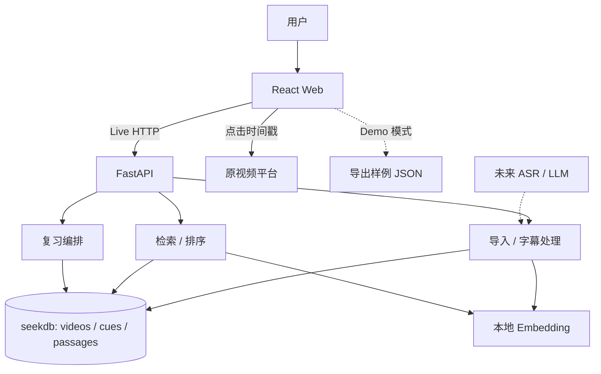

# 「听见」架构与模块规范 v1.0（终稿）

> **定位**：Goal-Oriented 一日交付终稿
> **制定日期**：2026-10-28
> **目标执行者**：具有较高自主性、可持续运行和自测的 Coding Agent（Qoder `/goal` 为主要开发方式）
> **产品目标**：构建基于 **seekdb** 的模块化单体课程视频字幕检索与复习系统。
> **约束目标**：争取在 **8 小时内**完成核心闭环及交付；时间是执行目标，真实验收结果决定是否完成。

## 0. 结果定义：Agent 必须交付什么

最终应存在一套**真实可运行**的软件，让用户完成以下闭环：

1. 输入 **B 站视频 URL（首选）** 或上传 SRT/VTT 字幕，绑定课程、讲次与来源 URL；字幕及时间戳**第一时间写入真实 seekdb**。
2. 自动按上下文切分为 `passage`，保留与原始 `cue` 的可追溯关系；同一来源重复导入幂等。
3. 输入自然语言，按全文（优先）与语义（增强）两路召回，RRF 融合、去重，得到带命中依据与时间戳的片段。
4. 点击结果，按平台可用能力打开原视频并跳转；跳转前可查看字幕上下文；本地视频可由用户临时选取并在浏览器中播放。
5. 运行 React Web UI：Live 模式连接 FastAPI + 真实 seekdb；Demo 模式用于 Qoder Sites，明确标识静态样例来源。
6. 提供自动化测试、真实数据库探针、检索评测结果、运行说明、开源声明和开发证据。
7. **（P2，非首日必须）** 输入考点与时长预算，生成可调整的复习片段清单，输出总时长和选择理由。

**完成状态分级，禁止混淆**：

| 状态 | 真实含义 | 可否宣称全部完成 |
|---|---|---|
| `FULL` | 实际 seekdb 入库、B 站/SRT 字幕路径、全文 + 向量检索、融合、跳转、UI、测试、公开演示均通过；复习清单不要求 | 可以 |
| `CORE` | B 站/SRT 导入 → 真实 seekdb 关键词/全文搜索 → 跳转 → UI 完成；向量或复习未通过 | 不可以；明确列出未完成项 |
| `DEMO_ONLY` | 只有静态演示或 Mock 返回，缺少真实数据库链路 | 不可以 |
| `BLOCKED` | 外部环境、账号、平台等限制导致关键验收无法完成 | 不可以；保留最小复现证据 |

### 0.1 优先级

- **P0-0（第一关）**：B 站字幕获取（公开轨 + 用户脚本 SRT 兜底）、SRT/VTT 上传、`cues/passages` 落库、幂等、真实 seekdb 可查。
- **P0-1（核心闭环）**：全文检索 → 时间戳跳转 → 基础 Web UI → 可复现测试。
- **P0-2（增强）**：真实 Embedding、向量 + 全文双路召回、RRF、检索评测、Demo/Live 一致。
- **P2（后置）**：考点/预算复习清单、MMR、总时长/理由、可调整/持久化；ASR、LLM、用户记忆、登录协作。

> **门禁**：M0 字幕落库未通过，不得开始搜索、UI 或复习清单。
> **降级顺序**：B 站公开轨失败 → 用户脚本导出 SRT 兜底；向量不可用 → 先保全文；复习清单永远最后。

---

## 1. 架构不变量

1. **原始事实可重建**：`cue` 的原文和起止毫秒必须保留；`passage`、Embedding 与索引可再生成。原始字幕替换须采用明确的重新导入行为，不静默覆盖。
2. **seekdb 唯一 Live 检索真库**：Live 读写实际经过 seekdb。SQLite 只允许作为可选的纯测试替身；不要求 Agent 为 SQLite 实现与 seekdb 完全等价的全文/向量功能。
3. **必要的隔离**：数据库、Embedding、字幕源与播放链接有清晰边界。是否使用 Protocol、抽象类或简单函数接口由 Agent 决定；同一个能力不得出现两套冲突的核心逻辑。
4. **媒体与凭据边界**：仅保存字幕、元数据与来源 URL；不托管、不批量下载源视频。服务端不保存平台 Cookie。云端模型密钥、付费内容和登录态不是默认运行依赖。
5. **结果可溯源**：`SearchHit` 至少返回 `video_id / passage_id / start_ms / end_ms / cue_start_seq / cue_end_seq / source_url / text`；时间区间能够对应真实原始字幕。
6. **版本足够可恢复**：记录 `schema_version`、Embedding 模型标识与切块版本；提供可重复执行的重建/重新入库脚本。第一天不开发通用迁移平台或复杂版本管理 UI。
7. **真实验收优先**：禁止编造测试结果、手写伪造数据库日志、修改断言躲过失败、用 Demo/SQLite/FakeEmbedder 冒充 seekdb 或真实语义能力。

**由结果推导实现**：除上面红线、明确 API 契约和关键数据字段外，其余文件组织、类数量、辅助库选择允许 Agent 自主简化。

---

## 2. 系统拓扑与运行模式



### 2.1 Live 模式

- 运行 FastAPI 与 seekdb，允许 B 站/SRT 字幕导入、生成索引、搜索；复习清单为 P2，可用时再开。
- `/api/health` 返回真实数据库连通性、能力和运行模式；失败时如实返回错误状态。
- 前端所有检索结果由实际 API 获取；不得在异常时静默切到假结果。

### 2.2 Demo 模式

- 部署到 Qoder Sites 的静态前端，标识 `Demo / 示例字幕数据`，与 Live 复用同一套组件及 DTO。
- 由 Live 模式**实际查询或真实样本导出** `fixture.json`；可以在浏览器内进行轻量关键词过滤与固定示例检索。
- Demo 必须说明检索能力边界；不得宣称浏览器本地关键词过滤等于 seekdb 混合检索。
- 静态页无法直接运行本地 seekdb，需在 README 中明确区分本地真库演示和公网静态站。

---

## 3. 模块边界与依赖方向

逻辑上按职责划分，**不强制 18 个独立包或 18 组抽象**。一个物理文件可负责相邻的小模块，避免 Agent 在大量空接口之间来回跳转。

| 逻辑模块 | 必需输出 / 职责 | 推荐边界 | 验收 |
|---|---|---|---|
| Domain | `RawCue / Passage / SearchHit / Playlist`、领域异常 | `domain.py` | 纯逻辑单测 |
| Bilibili Source（P0） | B 站 URL → bvid/cid/part、元数据、公开字幕轨；失败分类；用户脚本 SRT 兜底 | `bilibili.py` | 真实 B 站样例 + 失败分类 |
| Subtitle（P0 兜底） | SRT/VTT 解析、时间校验、切块 | `subtitles.py` | 完整性测试 |
| Store | seekdb schema、读写、幂等、索引、检索 | `store.py` | **真实 seekdb 集成测试** |
| Embedder | `bge-small-zh-v1.5` 或兼容替代的真实向量化 | `embeddings.py` | 实际模型向量/查询测试 |
| Search | 关键词、向量召回、RRF、时序去重 | `search.py` | 基线 + 混合对照 |
| Review（P2） | 预算选片、MMR 或覆盖贪心、保存/读取；不进入首日 DoD | `review.py` | 预算/去重/可恢复（P2） |
| Playback | URL 生成、时间戳偏移、平台能力说明 | `playback.py` | 各 URL 类型测试 |
| API | 上传、B 站导入、查询、能力矩阵、错误映射 | `main.py` | API 集成测试 |
| Web | 课程库、搜索、来源跳转、导入、Demo；复习页 P2 可隐藏 | `apps/web/` | Build + 浏览器检查 |
| Eval & Scripts | 探针、导入、重建、评测、导出证据 | `scripts/` | 可重复执行 |

**依赖方向**：`web → api → domain/services → store/embedding/playback → 外部系统`。业务函数不直接依赖 Web；数据库访问集中，避免散落 SQL。

### 3.1 推荐工程目录（可按现有工程调整）

```text
tingjian/
├── apps/
│   ├── api/
│   │   ├── main.py
│   │   ├── domain.py
│   │   ├── store.py
│   │   ├── bilibili.py
│   │   ├── subtitles.py
│   │   ├── embeddings.py
│   │   ├── search.py
│   │   ├── review.py
│   │   └── playback.py
│   └── web/
│       ├── src/
│       └── package.json
├── fixtures/              # 自有 / 授权字幕；无敏感数据
├── tests/
│   ├── unit/
│   └── integration/
├── scripts/
│   ├── db_probe.py
│   ├── verify_m0.py
│   ├── import_bilibili.py
│   ├── import_fixture.py
│   ├── eval_run.py
│   ├── reindex.py
│   └── export_demo.py
├── qoder/                 # 实际开发过程与证据
├── ARCHITECTURE.md       # 本文件
├── README.md
├── THIRD_PARTY_NOTICES.md
└── .env.example
```

允许代理根据克隆的合法开源代码实际结构调整路径。**先复用能力，再统一数据类型和 API；避免导入多个彼此冲突的全套框架。**

---

## 4. 数据模型与 seekdb 约束

### 4.1 最终逻辑表

| 表 | 最小字段 | 作用 |
|---|---|---|
| `meta` | `key, value` | `schema_version`、`embedding_model`、`chunk_version` |
| `courses` | `id, name, term` | 课程 |
| `videos` | `id, course_id, title, source_url, source_type, platform, platform_video_id, part_index, cid, subtitle_kind, duration_ms, offset_ms, source_hash` | 讲次与来源 |
| `cues` | `id, video_id, seq, start_ms, end_ms, text` | 原始字幕事实 |
| `passages` | `id, video_id, course_id, start_ms, end_ms, text, tokens, cue_start_seq, cue_end_seq, embedding, index_version` | 检索片段与向量 |
| `playlists`（P2） | `id, title, topic, budget_ms, created_at` | 复习清单 |
| `playlist_items`（P2） | `playlist_id, passage_id, rank, clip_start_ms, clip_end_ms, reason` | 复习项 |

字段可以加索引、视频周次、来源版本和模型信息，但不得丢失 `cue` → `passage` → `search hit / playlist item` 追溯链。

### 4.2 关键字段与约束

- 所有时间统一为 **非负整数毫秒**；`0 ≤ start_ms < end_ms`。
- `cues` 对 `(video_id, seq)` 唯一；`passages` 必须记录包含的 cue 序号区间。
- `videos` 对 `(platform, platform_video_id, part_index)` 唯一；B 站多 P 每 P 一讲，`cid` 必填（可用时）。
- 课程与讲次采用稳定 ID；重复导入同一来源与字幕内容应幂等。
- `source_hash = sha256(canonical_json{video_id, platform, platform_video_id, part_index, cues[{seq,start_ms,end_ms,text}], language, source_type})`；字段排序、去空白。内容改变时应触发明确的版本更新或覆盖重建，不出现新旧 passages 混用。
- `embedding` 维度与配置中真实模型维度一致；本版首选 `bge-small-zh-v1.5`（512 维），更换时须重建索引。
- `passages.index_version` 与 `meta.index_version` 一致；重建时新版本写入成功后再原子切换，失败保留旧版。
- `embedding` 只在 ingest/store 内部流转；API、前端和 fixture 通过显式 DTO 裁剪，不直接序列化 domain 对象。
- API、前端和 fixture 中**排除完整 Embedding 与内部分词 token**。
- 数据库关系通过业务约束、事务和适合当前数据库环境的外键/索引实现，不假定所有 SQL 功能在所有运行模式都可用。

### 4.3 SQL 不变量与探针先行

**原文中的 SQL 是目标模型，不能不经验证就按字面执行。** Agent 必须先运行 `scripts/db_probe.py`，记录：

1. seekdb 包版本、部署形态、Python 版本和数据库连接方式。
2. `CREATE TABLE`、插入、查询和事务是否正常。
3. VECTOR 字段、向量索引、向量距离、近似排序能否在当前版本运行。
4. 全文索引和中文分词器（如 `ik`）是否可用、中文词组能否命中。
5. 单表向量和全文索引能否共存；标量过滤、JOIN 是否符合实际语义。

应优先使用 seekdb 官方支持的路径之一：SQL 兼容连接驱动，或经验证能覆盖需求的官方 Python API。**完整自定义 SQL Schema 与 Collection API 二选一作为主要写入/查询通路**，避免两个存储模型同时成为事实源。

索引 DDL 的选择必须记录实测。示例仅供探测，**不是跨版本承诺**：

```sql
-- 以真实探针核对语法、字段与模型维度
-- FULLTEXT INDEX ft_passages(text) WITH PARSER ik
-- VECTOR INDEX vec_passages(embedding)
--   WITH (DISTANCE=cosine, TYPE=hnsw, LIB=vsag)
```

**降级规则**：单条 SQL 不支持联合召回时，改为同一 seekdb 中分别执行向量和全文查询，再在应用层 RRF；仍视为真实混合检索。若当前环境无法建立向量索引，可以尝试数据库向量距离精确召回；若连真实向量能力也不能运行，保留可用全文检索并标记 `hybrid_search=false`，不得宣称 FULL。

### 4.4 幂等及可恢复

- 单次导入在逻辑上原子：失败不得留下孤立 passages 或残缺视频。
- 重建流程应可重复执行，使用已保存的 cues 重新切块和向量化。
- Embedding 失败时可保留原始 cues 并记录明确状态，全文搜索仍可运行；后续恢复向量化。
- 一天内不开发通用数据库迁移框架；使用单版本建库脚本与可重建索引即可。

---

## 5. 输入、切块与播放

### 5.1 字幕输入（B 站优先，SRT 兜底）

**P0 首选 B 站 URL**：解析 `bvid/cid/part` → 拉元数据 → 尝试公开字幕轨 → `fetch_cues` → 落库。

- 无公开轨、需登录、风控或地区限制：返回明确失败类型（`TRACK_NOT_AVAILABLE / ACCESS_RESTRICTED / RATE_LIMITED / NETWORK_ERROR`），引导用户用「视频字幕提取器 Pro」导出 SRT 后上传；**不把 Cookie 送服务端**。
- SRT/VTT 上传是兜底入口，不是唯一入口；两种路径共用同一 `RawCue` 与落库流程。
- SRT/VTT 允许 UTF-8/UTF-8 BOM 与常见换行；其他编码转换需明确报告结果。视频必须具有可访问来源 URL 或清楚标识本地来源。
- 解析时必须验证编号顺序、空内容、时间范围、跨段重叠、结束前于开始等异常；合法字幕不可被静默丢弃。允许空 cue 文本被跳过，但需记录数量。
- **验收：至少 1 个真实 B 站样例完成导入**（公开字幕轨或用户脚本 SRT），记录实际路径；无字幕来源的 ASR 仍为 P2。

### 5.2 Passage 切块

- 按 cue 顺序形成连续时间窗口，初始目标 **20–45 秒**，允许调整字符数量和窗口重叠。
- 上限优先：下一 cue 加入后显著超过时间/字符上限时先结束当前窗口；单条超长 cue 必须有安全处理。
- 保留原始 `cue_start_seq / cue_end_seq`；可有 1 条 cue 重叠，但同一原始 cue 只能在源表出现一次。
- 尾段不足长度可以保留；不得为满足最小长度而丢弃字幕。
- 验收要求：每个非空 cue 至少被一个 passage 覆盖；时间顺序、区间映射正确；可从 passage 找回原文。

### 5.3 播放

- 标准出参包含 `start_ms`、`end_ms`、`jump_url`、`playback_capability`。
- 时间偏移：`jump_ms = max(0, start_ms + offset_ms)`；不得把字幕时间与视频播放时间混淆。
- 对 YouTube/B 站/直链分别验证实际跳转行为；无法在 iframe 精确控制的平台使用官方 URL / 新标签降级并展示提示。
- 本地视频可由用户在浏览器中临时选择，使用 `URL.createObjectURL` 播放并按毫秒 seek；文件不上传、不托管。关闭页面后如需重看，需要重新选取本地文件。
- 不承诺源视频下架、登录墙或地区限制时仍能播放。

---

## 6. 检索与复习算法：保留目标，放开参数

### 6.1 两路召回

1. `lexical`：seekdb 全文查询，返回 Top-K；对中文词汇测试分词命中。
2. `semantic`：真实 Embedding 对查询向量化，通过 seekdb 向量距离/索引召回 Top-K。
3. 对候选应用课程/讲次等结构化过滤；优先数据库侧过滤，实际不可行时说明原因并应用层过滤。
4. RRF 融合，以 `1/(k + rank)` 为基础；默认可用 `k=60`，作为可配置参数。
5. 对同一视频的强重叠区间合并或去重，保留高分段并允许展开原文上下文。

**修订原文的重要参数假设**：取消固定 `cosine < 0.45` 截断、`+0.08` 跨课程奖励、`start_delta < 15000ms` 一律丢弃。参数由小样本评测决定；首版优先保证命中率与原文追溯。无答案查询必须允许返回空集，并展示判断规则。

### 6.2 检索返回的解释性

每条结果需要有：

- `match_reason`：关键词命中、语义召回、两路共同命中等**基于真实召回路径**的理由。
- `score` / `rank`：最终排序信息；若只存在应用层相对分数须说明不是概率。
- `source`：课程、视频标题、时间戳、原文与跳转 URL。

不得用 LLM 猜测“这段讲了什么”作为真实召回理由。

### 6.3 预算复习清单（P2，后置）

> 本节为 **P2**，不进入首日 DoD；核心闭环（字幕落库 → 搜索 → 跳转 → UI）完成后再实现。保留算法目标，不作为 M0/M1 验收项。

- 输入主题/考点与 `budget_ms`，通过检索拿到候选 passage。
- 默认按覆盖增益、相关度与冗余惩罚贪心选择；当向量存在时可加入 MMR 多样化。
- 合并同视频重叠播放区间，实际播放时长**不超过预算**；切片边界必须有合法字幕支持。
- 同一知识点在多门课中重复出现时尽量选覆盖更好的讲解；跨课程多样性是弱偏好，不要求每份清单至少两门课。
- 生成结果展示选入理由，支持手动删除/调整顺序，并可持久化读取。
- 若 MMR 未实现，允许先使用简单覆盖贪心，但不得将其标识为已实现 MMR。

---

## 7. HTTP API 与统一数据契约

| 方法 | 路径 | 最小语义 |
|---|---|---|
| `GET` | `/api/health` | Live/Demo、数据库健康及功能能力 |
| `GET` | `/api/courses` | 课程列表 |
| `GET` | `/api/videos?course_id=...` | 讲次列表 |
| `POST` | `/api/import/bilibili` | 输入 B 站 URL，拉公开字幕轨并落库；失败返回可读错误 |
| `POST` | `/api/import/srt` | 上传字幕、视频元数据、导入结果 |
| `GET` | `/api/search?q=...&limit=5` | 查询与可跳转结果 |
| `POST` | `/api/playlists`（P2） | 生成/保存限时复习清单 |
| `GET` | `/api/playlists/{id}`（P2） | 获取清单与播放区间 |

建议 `/api/health` 返回：

```json
{
  "mode": "live",
  "store_ok": true,
  "database": "seekdb",
  "course_count": 2,
  "video_count": 10,
  "capabilities": {
    "lexical_search": true,
    "vector_search": true,
    "hybrid_search": true,
    "bilibili_import": true,
    "bilibili_browser_fallback": true,
    "review_playlist": false,
    "asr": false,
    "llm_summary": false
  }
}
```

> `bilibili_import=true` 仅当至少一个真实 B 站样例通过公开轨导入成功；`bilibili_browser_fallback=true` 表示始终支持用户脚本 SRT 上传；`review_playlist` 在 P2 实现前必须为 `false`。

上面为**响应形状示例**，不是实际运行报告。各字段必须反映当前运行能力，不能默认全部为 `true`。

`SearchHit` 示例：

```json
{
  "passage_id": "p-001",
  "video_id": "v-001",
  "course_id": "c-001",
  "video_title": "数据库原理第 3 讲",
  "start_ms": 754000,
  "end_ms": 787000,
  "cue_start_seq": 140,
  "cue_end_seq": 148,
  "text": "事务的隔离性……",
  "source_url": "https://example.com/authorized-video",
  "jump_url": "https://example.com/authorized-video?t=754",
  "playback_capability": "external_seek",
  "match_reason": "lexical+semantic",
  "score": 0.031
}
```

示例 URL 仅用于说明字段；真实跳转地址由各平台适配器生成，不能直接依赖示例参数格式。

错误需具有机器可读 `code` 与用户可读 `message`，如 `BAD_SUBTITLE`、`DB_UNAVAILABLE`、`EMBEDDING_UNAVAILABLE`、`PLAYBACK_UNSUPPORTED`。API 应提供一致的错误状态码，便于前端处理。

---

## 8. UI 验收（React 19 + Vite + Tailwind 4 + shadcn/ui）

首屏以 **搜索** 为中心：顶部搜索框、课程筛选、结果列表、时间戳、原文预览、跳转按钮。

P0 三个视图 + 一个 P2 视图：

1. **课程库**：已有课程、讲次、字幕状态与导入入口。
2. **知识搜索**：自然语言查询、Top 3–5 结果、命中来源、原视频定位。
3. **字幕导入（P0 重点）**：B 站 URL 优先，SRT/VTT 兜底；展示元数据/字幕预览、导入进度与失败提示。
4. **复习清单（P2，首日可隐藏）**：输入主题、时间预算，查看总时长、选段原因、顺序与移除。

导入页交互：粘贴 B 站 URL → 拉元数据/公开字幕 → 预览 → 落库；失败时显示“用「视频字幕提取器 Pro」导出 SRT 后上传”，不弹崩溃错误。无公开字幕时，SRT 上传仍能完成同一落库流程。

前端以同一 DTO 支持 Live 与 Demo；Demo 在顶栏持续标识，UI 不应绘制虚假的已完成 AI 总结/ASR 功能。可对暂未实现的扩展显示简短产品路线说明。

优先做到排版清晰、中文可读、响应快速；动画、复杂播放器控制及手机端细节优先级次之。

---

## 9. 开源复用计划：积极复用，拒绝多框架堆叠

允许大量复用**已确认许可的代码和组件**，以实测兼容性决定复用量。优先参考：

| 能力 | 参考项目 | 复用重点 |
|---|---|---|
| B 站/多平台字幕流程 | [Video-Captions](https://github.com/LuShan123888/Video-Captions) | 字幕标准化、Provider 组织；ASR 的平台依赖需另验 |
| 浏览器字幕导出（P0 兜底） | [视频字幕提取器 Pro](https://greasyfork.org/zh-CN/scripts/563012) | MIT；用户脚本导出 SRT，浏览器侧拿登录态，服务端不碰 Cookie |
| 浏览器字幕与跳转交互 | [AliceDel66/BiliNote](https://github.com/AliceDel66/BiliNote) | 浏览器侧字幕处理、时间戳交互 |
| 视频笔记/任务流程 | [JefferyHcool/BiliNote](https://github.com/JefferyHcool/BiliNote) | 异步操作、笔记组织；不要直接搬入不需要的重型依赖 |
| RAG 与时间戳引用 | [youtube-research-assistant](https://github.com/codebyj857/youtube-research-assistant) | 分块、检索与引用测试（**该仓库无 LICENSE，只读思路**） |
| seekdb 接口与示例 | [pyseekdb](https://github.com/oceanbase/pyseekdb)、[seekdb](https://github.com/oceanbase/seekdb) | 官方实现、SQL/SDK 探针、索引能力 |

落地要求：

- 先检查 LICENSE、实际文件版权头、依赖许可，再复用代码。
- 只导入当前功能必要的文件；对原仓库依赖和版本进行扫描，避免出现无法部署的大型依赖链。
- `THIRD_PARTY_NOTICES.md` 记录项目、URL、许可证、复用文件、修改说明及归属。
- B 站字幕方案涉及接口及平台规则风险；公开轨优先，失败即切用户脚本 SRT；演示优先使用自有、授权或允许公开使用的字幕与视频。
- **B 站优先级的边界**：服务端只尝试公开字幕轨；登录态/风控场景交给浏览器脚本导出 SRT；不把 Cookie 送服务端。
- **无 LICENSE 仓库只读思路**：`youtube-research-assistant`、`yyyzl/bilinote`、`VideoSense` 不复制代码；其余 MIT/Apache 组件按 NOTICE 记录。

---

## 10. Agent 自验证机制（DoD）

### 10.0 M0 门禁：字幕落库（必须先过）

在写搜索/UI 之前，必须完成并记录：

1. `python scripts/db_probe.py`：seekdb 可建表、写入、查询。
2. 至少 1 个真实 B 站样例：`POST /api/import/bilibili` 公开轨成功，**或**用户脚本导出 SRT + `POST /api/import/srt`（带 `source_url`）。
3. `cues`/`passages` 行数与解析结果一致；`source_hash` 已写入；同一来源二次导入行数不增长。
4. `SELECT` 能按 `video_id` 查回 `cue` 的 `start_ms/end_ms/text`。

**不满足以上 4 条，不得开始搜索、UI 或复习清单。**

### 10.1 测试层次

**纯逻辑单测（必需）**：SRT/VTT 解析、B 站 URL 解析、切块覆盖、时间戳、去重、RRF 排序、预算与时长合并。

**真实 seekdb 集成测试（必需）**：建表、插入、重复导入、查询、原文溯源、索引重建与重启后持久性。至少有一条搜索在真实 seekdb 中返回准确字幕。

**B 站/字幕落库测试（P0 必需）**：B 站公开轨或用户脚本 SRT 至少一条路径跑通；失败类型可读；同一来源幂等。

**向量/混合测试（FULL 必需）**：使用真实 Embedding，检查维度、索引与查询；分别输出全文、向量、融合三组结果。不得使用 hash FakeEmbedder 的输出证明语义能力。

**API/UI 测试（必需）**：导入后可搜；点结果能实际打开并尽量定位一个可访问的样例视频；两种前端模式均构建且能够渲染。

**清单测试（P2，可选）**：预算不超限、同视频重叠片段不重复计时、选入依据可追溯、重启后仍能读取。

### 10.2 检索评测

准备不少于 **20 条真实标注查询**（建议 12 条原词、5 条同义改写、3 条无答案），记录：

- Hit@3：Top3 是否包含人工标注的相关区间；可设置 ±15 秒容差，但要说明判定规则。
- 无答案识别：语料不含答案时是否正确拒绝返回。
- Top3 对照：全文、向量、混合三组分别计算；不将用户点击率伪装成 Hit@3。
- 检索延迟与导入时间：记录实际测量环境和样本规模。

不预设未经校准的 80% 命中门槛；**评测脚本必须真实运行，报告实际分数与失败样本**。

### 10.3 验收脚本（Agent 应创建并运行）

建议统一 `scripts/verify.sh`（Windows 环境附 PowerShell 或 WSL 指令），依次执行：

```bash
python scripts/db_probe.py
python scripts/verify_m0.py      # B 站/SRT 导入 + 幂等 + SELECT
pytest tests/unit -q
pytest tests/integration -q
python scripts/eval_run.py --output artifacts/metrics.json
cd apps/web && npm run build
```

`verify_m0.py` 是新增的 M0 门禁脚本：至少跑一条 B 站样例或 SRT 兜底，打印 `cues/passages` 行数、二次导入前后行数、按 `video_id` 查回的原文与时间戳。M0 未过，后续命令不执行。

执行环境不同可改命令，但要在 README 中写明完整等价命令，留下**真实**终端输出或机器可读报告。

关键错误发生后，先归因、复现、修复，再重跑相关测试；保持历史测试结果原样，不覆盖失败证据以冒充从未失败。

### 10.4 防止自动代理误判完成

以下情形**不能**宣告 FULL：

- 只通过 SQLite、Mock、FakeEmbedder 的测试，未实际连接 seekdb。
- 页面能搜索 fixture，但 Live API 未实现。
- 数据库中存在向量字段，却没有真实模型生成与相似度查询验证。
- API 返回跳转链接，但没有验证至少一个真实样例能定位。
- **没有完成 M0 字幕落库门禁**（B 站/SRT 导入 + 幂等 + SELECT）。
- **复习清单仅展示预置数组**（P2，不参与 FULL 判定，但不能冒充已实现）。
- 构建全绿但缺少公开站点可访问性检查和 Qoder 开发记录。

---

## 11. 一日 `/goal` 执行策略：纵向推进，最终功能尽量完整

采用**里程碑关卡**而非逐模块交接；Agent 可以重排实现顺序，但应尽早产生可演示的纵向切片。

| 建议时间盒 | 交付关卡 | 通过条件 |
|---|---|---|
| H0–H1 | 环境 + seekdb 探针 + B 站接口探针 | 实际 seekdb 能建表、写入、查询；B 站元数据/公开轨可解析或明确失败 |
| H1–H2.5 | **字幕落库（B 站 + SRT）** | `cues/passages` 入库、`source_hash` 幂等、SELECT 可查；M0 门禁通过 |
| H2.5–H4 | 全文检索 + 跳转 + 最小 UI | 真实字幕可搜可跳 |
| H4–H5.5 | 真实 Embedding + 双路/RRF + 评测 | 三组结果与 `metrics.json` |
| H5.5–H7 | UI/Demo/证据 | 构建、无痕站点、真实记录 |
| H7–H8 | Qoder/发布/提交 | `workUrl`、开发记录 |
| 之后（P2） | 复习清单 | 预算/理由/可调整；不占首日 |

**B 站阻塞处理**：公开轨失败时，H1–H2.5 内切到用户脚本 SRT 兜底，**不把 M0 拖到 H3 之后**。M0 未过，H2.5 的搜索/UI 不启动。

时间盒属于调度建议，**不强制在时间到达时砍掉已接近完成的可验证功能**。但应优先保证公开交付、真实数据库证据和核心用户链路，不在最后阶段引入复杂外部新服务。

### 11.1 遇到阻塞时的决策顺序

1. 提取最小复现，查询官方文档及现有项目的真实用例。
2. 调整内部实现而保持用户可见的 API 契约。
3. 若单条 SQL 不支持，拆成真实 seekdb 双查询 + 应用层 RRF。
4. **若 B 站公开轨失败（登录/风控/无轨），立即切用户脚本 SRT 兜底，记录失败类型；不因 B 站阻塞 M0。**
5. 若 Embedding 或平台跳转受限，明确标记能力缺失，优先完成其余闭环。
6. 无法按时通过完整验收时，交付已经真实通过的状态与未完成清单，禁止假装 FULL。

### 11.2 必要的人类参与点

- 首次选择授权字幕及来源视频；涉及账号登录、平台权限与发布授权时由用户处理。
- 确认仓库权限、Qoder Sites 的访问设置及正式发布。
- 涉及删除用户文件、覆盖已有仓库和公开发布敏感内容等操作必须符合当前授权。

---

## 12. 证据链与交付目录

最少需要：

- `README.md`：环境版本、安装、启动、导入、检索、验收命令、Live/Demo 差异。
- `scripts/db_probe.py` 与真实执行结果：证明 seekdb 实际运行及检索能力。
- `artifacts/`：SQL / API 结果、评测 JSON、关键截图或录屏说明（全部来自真实运行）。
- `artifacts/bilibili-import.*`：B 站 URL、实际路径（公开轨或用户脚本 SRT）、失败类型、`cues/passages` 行数。
- `qoder/`：真实开发会话、截图与相关材料。
- `THIRD_PARTY_NOTICES.md`：所有直接复用代码、许可及归属。
- 公网 `workUrl`：公开站点无痕访问测试通过；明确 Demo 类型。
- 本地运行项目：真实 seekdb 功能与样本复现说明。

---

## 13. 给 Coding Agent 的执行指令（可直接粘贴）

```text
/goal 阅读根目录 ARCHITECTURE.md，按其 v1.0 规范实现「听见」课程字幕检索与复习系统。 --turns 300

最终目标：单仓库模块化单体，React 19 + Vite + Tailwind 4 + shadcn/ui，
FastAPI + 真实 seekdb，实现 B 站/SRT/VTT 字幕导入与落库、cue/passage 数据保真、
全文 + 真实向量双路检索、RRF 融合、时间戳溯源及跳转、Live/Demo 双模式，
并提供自动测试和真实交付证据。复习清单为 P2，不在首日 DoD。

你可以自行选择最少的文件与类完成目标，允许合法复用开源模块、
安装依赖、改进数据结构、重构和持续自测，但必须保留文档定义的
业务不变量、核心数据字段、统一 API 与真实数据库要求。

在编写依赖具体 seekdb 语法的代码之前，先运行最小探针核对当前
seekdb 版本、Python 接口、中文全文和向量索引的实际行为。
不适配时先研究再修改内部实现，保留实测结果和失败原因。

优先实现 B 站 URL → 元数据/公开字幕 → cues/passages 落库；无公开字幕时引导用户用
「视频字幕提取器 Pro」导出 SRT 后上传；不保存 Cookie。

按“B 站/字幕落库（M0 门禁）→ 全文检索/跳转 → 最小 UI → 向量/RRF → 评测 → 发布”迭代；
复习清单 P2，不在首日 DoD。
在完成前运行全部适用的验证命令，对失败继续定位修复；
禁止跳过测试、删除关键验收、伪造日志或把 Demo/Mock 当真库。

目标是在一天内尽可能实现 FULL；如果有外部限制，必须明确给出
FULL / CORE / DEMO_ONLY / BLOCKED 状态、未完成事项、复现步骤和证据。

交付 README、测试与评测输出、开源声明、Qoder 实际开发记录以及
可访问的公开演示 URL（如果发布账号权限允许）。
```

`--turns` 以当前 Qoder CLI 实际支持的命令形式为准；此处为建议轮次上限，达到上限后需检查状态并决定是否继续。执行时推荐分别保存真实探针、测试和发布结果，避免长轮次中丢失上下文。

---

## 14. 主要技术风险与控制

| 风险 | 最低成本的控制方法 |
|---|---|
| seekdb Python 包与 SQL 访问方式混淆 | 先探针，选定单一路径，记录版本与样例查询 |
| SQL 全文分词器或向量索引不兼容 | 真库分别召回 + RRF；必要时精确向量搜索，显式降级 |
| Embedding 模型下载/加载缓慢 | 提前准备模型缓存；允许全文继续使用，但 FULL 必须验证真向量 |
| B 站字幕 API 风控及条款风险 | B 站优先，公开轨失败即切用户脚本 SRT；不保存 Cookie；演示用授权素材 |
| 静态站无法连接本地数据库 | 同构 UI、明确 Demo 标签；另附真实 seekdb 运行证据 |
| 大量复用导致依赖冲突 | 选一个底座、按能力最小移植；锁版本与许可证 |
| 清单预算偏差（P2） | 按真实播放区间合并计算，不按结果文本长度估算 |
| Agent 自行宣布完成 | 验收按实际数据库、测试输出、可访问 URL 和证据分级 |

---

## 15. 官方文档与复用参考

- seekdb 官方仓库：https://github.com/oceanbase/seekdb
- seekdb 官方网站及 SQL/混合检索介绍：https://www.seekdb.ai/
- pyseekdb SDK：https://github.com/oceanbase/pyseekdb
- seekdb Python SQL 包信息：https://pypi.org/project/seekdb/
- Qoder CN `/goal` 指南：https://docs.qoder.cn/cli/goal
- Qoder Sites：https://docs.qoder.cn/qoder/sites
- Video-Captions：https://github.com/LuShan123888/Video-Captions
- BiliNote（浏览器侧）：https://github.com/AliceDel66/BiliNote
- BiliNote（AI 笔记）：https://github.com/JefferyHcool/BiliNote
- YouTube Research Assistant：https://github.com/codebyj857/youtube-research-assistant

---

## 16. 执行准则

先把“B 站/字幕 → seekdb 落库”做成事实，再做搜索与跳转；复习清单最后再说。
